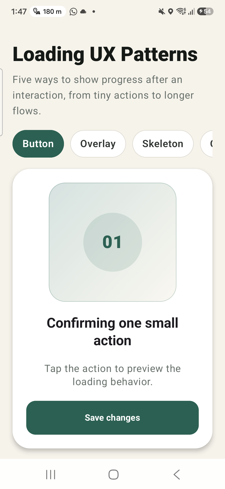

# Loading UX Patterns

Mini-projet Android/KMP pour explorer les patterns de loading dans une UI Compose.

Le but n'est pas de livrer une app complete, mais de comparer plusieurs manieres de montrer la progression apres une interaction :

- loading dans le bouton ;
- overlay de soumission ;
- skeleton loading ;
- feedback optimiste ;
- progression par etapes.

## Pourquoi ce mini-projet ?

Un loader n'est pas seulement un spinner. C'est une decision UX :

- est-ce que toute la page doit etre bloquee ?
- est-ce que seul le bouton doit reagir ?
- est-ce que l'utilisateur peut deja voir le resultat ?
- est-ce qu'il faut expliquer les etapes ?

Chaque pattern est interactif pour comparer rapidement le ressenti.

## Stack

- Kotlin Multiplatform
- Compose Multiplatform
- Material 3
- Android target pret a lancer

## Screenshots

<p align="center">
  
</p>

## Idee de post LinkedIn

> Un loader peut rassurer, bloquer, expliquer... ou fatiguer.
>
> Dans ce mini-projet Compose/KMP, je compare 5 patterns de loading : bouton, overlay, skeleton, optimistic UI et progress steps.
>
> La question interessante : quel pattern donne assez de feedback sans casser le flow ?

## Run

```bash
./gradlew :composeApp:assembleDebug
```
